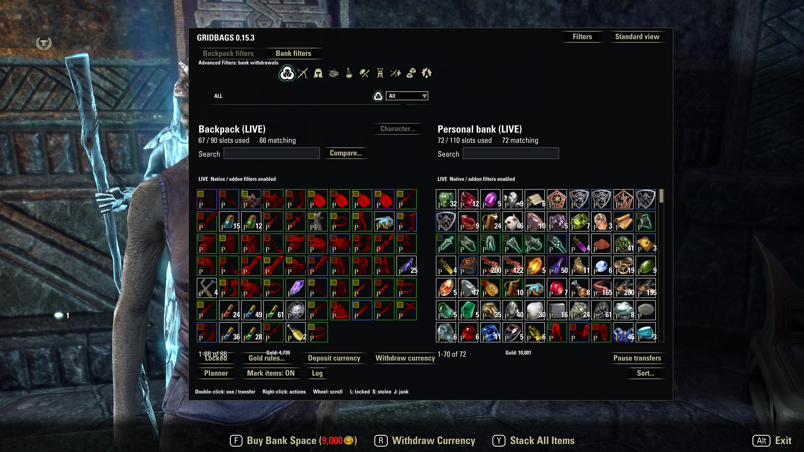
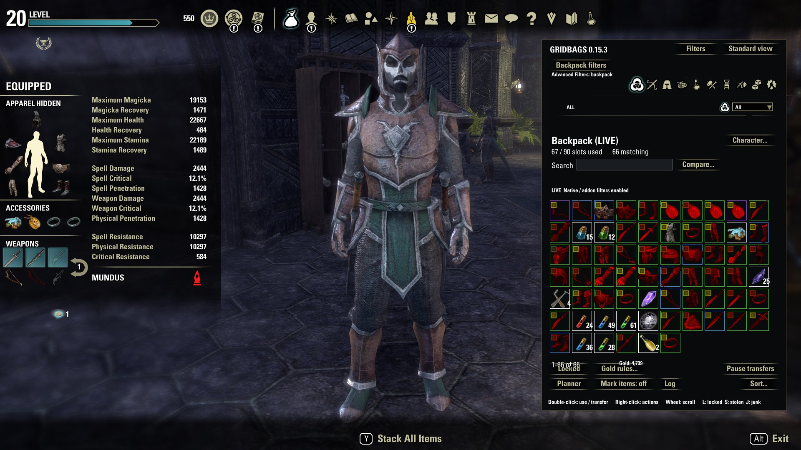
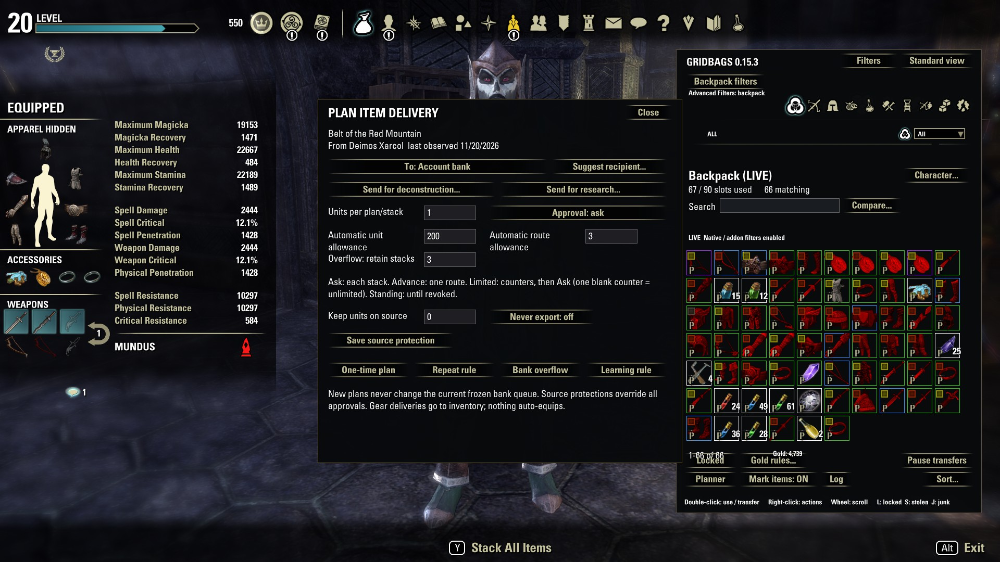
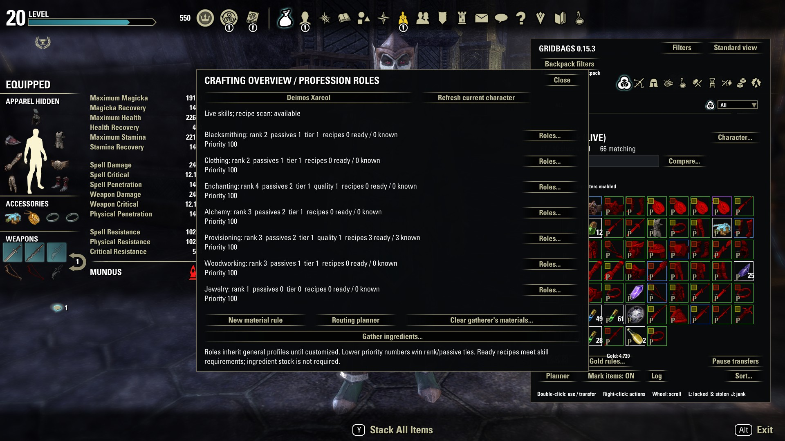
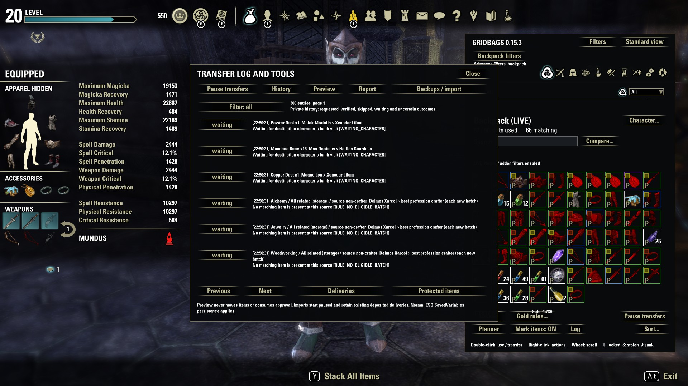

# GridBags (Beta)

Keyboard and mouse inventory grids and account inventory planning for The Elder Scrolls Online, by **XenoXanatos**.

GridBags 0.15.3 replaces backpack and personal-bank lists with searchable grids, while preserving native item actions. The first public beta packages the runtime tested during development; broader player and addon combinations still need testing.

## Download and install

Download **GridBags-0.15.3-beta.1.zip** from the GitHub prerelease assets, or the approved ESOUI listing when available. The GitHub Source code archives are development checkouts, not the installable addon ZIP.

Extract the `GridBags` folder into your ESO `live/AddOns` folder. Verify `AddOns/GridBags/GridBags.txt` exists, enable the addon and reload the UI. Open inventory with the usual key or visit a personal banker. Standard view returns to ESO's list; its GridBags view button brings back the grid. `/gridbags` also toggles it.

New installations contain **no automatic transfer rules or plans**. Your own account/world supplies your snapshots, profiles and inventory data. No other player's settings or character data are bundled.

Disable **GridList**, **GridPadInventory** and **BankManagerRevived** for initial testing. GridBags refuses planned transfers while BankManagerRevived is loaded to avoid two automatic movers competing.

## Features

- Backpack grid and side-by-side backpack/bank grids, searches, filters, row scrolling, movable/lockable layout, tooltips and native item actions.
- Searchable snapshots of other characters' backpacks and equipped gear, plus the last observed account bank. The active character stays live.
- Advanced Filters controls inside the grid and optional Research Assistant, Character Knowledge and CraftStore integration.
- Explicit item deliveries through the personal bank, per-stack confirmation, advance approval, limited allowances, repeat rules, protections and Any-source rules.
- Profession profiles, skill-aware recipient suggestions, native material ownership, separate style/trait categories, furniture-material retention and overflow destinations.
- Known-recipe ingredient needs and source previews, explicit confirmation and temporary ingredient holds. Crafting remains manual.
- Gear delivery suggestions for deconstruction/research and saved equipment comparisons; no automatic equip, research or deconstruction.
- Gold display, native deposit/withdrawal access and planned gold policies.
- Delivery overview, failure reasons, history, rule explanations, mouseover help, pause, read-only previews and configuration backups.
- Exact unique-item arrival reconciliation when the intended recipient already has the item, including duplicate historical delivery records.

## Screenshots

### Backpack and personal bank grids

### Backpack grid with Advanced Filters

### Plan item deliveries and approvals

### Crafting overview and profession profiles

### Transfer history and waiting reasons

## Dependencies and compatibility

**No required external libraries.** Optional integrations activate when their addons and required libraries are installed and enabled:

AdvancedFilters, LibFilters-3.0, LibAddonMenu-2.0, LibCustomMenu, ResearchAssistant, CharacterKnowledge, CraftStoreFixedAndImproved and BankManagerRevived. BankManagerRevived's native menu integration is optional, but its automatic mover must remain disabled for GridBags routing.

The manifest targets API **101051**. PC keyboard/mouse is the target; controller mode is not. Guild banks, housing storage and furnishing vault are not routing sources. Snapshots cannot move items remotely: each relevant character must visit a personal bank. Optional integrations are not a guarantee of compatibility with every addon combination.

## Beta testing and feedback

See the [testing checklist](docs/beta-testing.md), [changelog](CHANGELOG.md) and [development/credits](docs/development.md).

Report problems through this repository's Issues. Include version, reproduction steps and relevant reason codes. Log > Report provides a redacted diagnostic report. Do not post complete SavedVariables, private inventory data or unreviewed screenshots publicly.

Automated validation: **905 Lua 5.1 mocked behavior checks**, plus 39 optional installed-addon contract checks. Saved-data replays are additional mock evidence. Game tests have confirmed the main inventory/bank, routing, ingredient gathering and exact-item reconciliation flows on the development setup; wider beta testing remains necessary.

## License

MIT. Copyright (c) 2026 XenoXanatos. Third-party addons are not bundled or relicensed. See [LICENSE](LICENSE) and the credits above.
